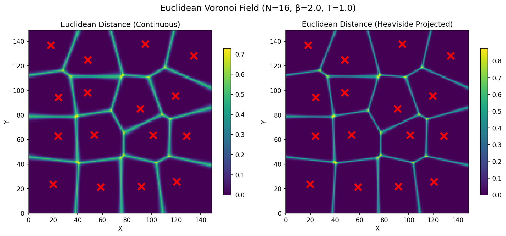
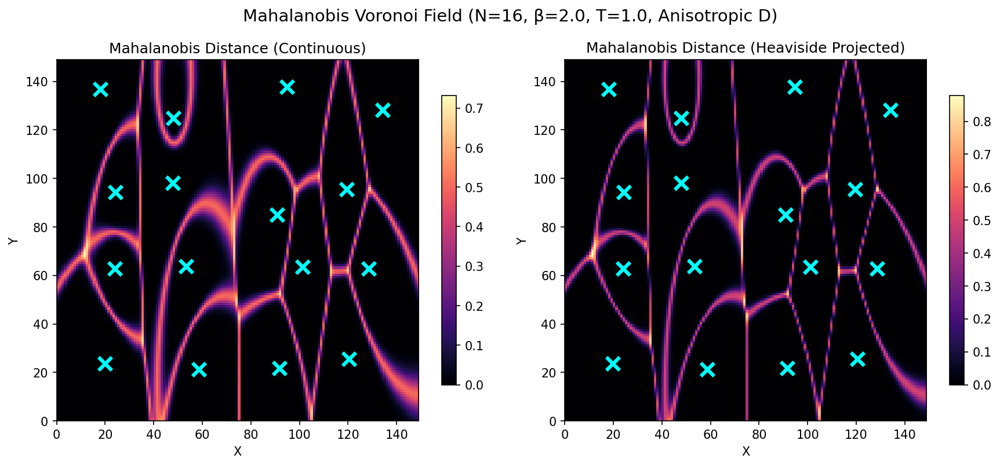

# Voronoi Core

**English** | [中文](README_zh.md)

High-performance Voronoi field computation library based on JAX.

## Citation

This project is the core computational module of the following paper:

> Changkun Sun, Yongbo Deng, Nanya Li. **Differentiable Voronoi diagram towards a new design method for the additive manufacturing of 3D disordered cellular structure**. *Engineering Structures*, 364:123138, July 2026. DOI: [10.1016/j.engstruct.2026.123138](https://doi.org/10.1016/j.engstruct.2026.123138)

## License

This project is open-sourced under the [MIT License](LICENSE). You are free to use, modify, and distribute the code, provided that the copyright notice is retained.

## Installation

### Option 1: pip install

```bash
pip install -e .
```

Then import the modules directly:

```python
from density import soft_density
from field import compute_voronoi
from utils import generate_identity_D
```

### Option 2: git submodule

```bash
git submodule add <repo-url> d_Voronoi_core
```

Then add the parent directory of `d_Voronoi_core` to the Python path, or import directly:

```python
import sys
sys.path.append('path/to/parent')
from d_Voronoi_core import compute_voronoi
```

## Dependencies

- `jax>=0.4.0`
- `jaxlib>=0.4.0`
- `numpy>=1.24.0`

## Terminology

| Term | Description |
|------|-------------|
| **seed** | Voronoi seed point |
| **unit** | Query point / field point |
| **D** | Transformation matrix (D=I for Euclidean distance) |
| **cp** | Control point (affects direction sensitivity) |

## Demo

### Euclidean Voronoi Field

Standard Voronoi using Euclidean distance (D=I). Left: continuous density field; Right: after Heaviside projection.



### Mahalanobis Voronoi Field

Anisotropic Voronoi using Mahalanobis distance with different D matrices. Each seed point has its own transformation matrix, creating directional stretching effects.



## Quick Start

```python
from field import compute_voronoi, make_voronoi_fn
from density import compute_gamma
import numpy as np

# Create grid
Nx, Ny = 100, 100
coords = np.stack(np.indices((Nx, Ny)), axis=-1)

# Seed points
seeds = np.array([[25, 25], [75, 25], [50, 75]], dtype=float)
N = seeds.shape[0]

# Transformation matrix (D=I for Euclidean distance)
D = np.tile(np.eye(2), (N, 1, 1))

# Option 1: Direct call
field = compute_voronoi(coords, seeds, D, beta=2.0, temperature=1.0)

# Option 2: Pre-bind static parameters (recommended for optimization loops)
voronoi = make_voronoi_fn(beta=2.0)
for epoch in range(100):
    eta = 0.3 + 0.4 * (epoch / 100)
    gamma = compute_gamma(epoch)
    field = voronoi(coords, seeds, D, temperature=1.0, eta=eta, gamma=gamma)
```

## Distance Types

Switch between distance types using D matrix and cp parameter:

```python
from distances import mahalanobis_single

# 1. Euclidean distance (D=I)
D_I = np.tile(np.eye(2), (N, 1, 1))
dist = mahalanobis_single(unit, seeds, D_I)

# 2. Mahalanobis distance (anisotropic)
D = np.array([[[2, 0.5], [0.5, 1]], ...])
dist = mahalanobis_single(unit, seeds, D)

# 3. Masked Mahalanobis distance (direction-aware)
cp = seeds + np.array([5, -5])
dist = masked_mahalanobis_single(unit, seeds, D, cp, sigma=0.1, scale=3.0)
```

## Function Signatures

### `compute_voronoi`

```python
def compute_voronoi(
    coords,        # Field coordinates (Nx, Ny, dim)
    seeds,         # Seed points (N, dim)
    D,             # Transformation matrix (N, dim, dim)
    cp=None,       # Control points (N, dim), optional
    beta=2.0,      # Boundary sharpness (keep around 2 or 2.66)
    sigma=0.1,     # Mask width (0.03-0.3)
    scale=3.0,     # Mask strength (1-5)
    temperature=1.0,  # Temperature coefficient T (controls structure width)
    eta=0.5,       # Heaviside threshold (0.3-0.7)
    gamma=1.0,     # Projection sharpness (compute_gamma(epoch))
    batch_size=20
)
```

### `make_voronoi_fn`

```python
voronoi = make_voronoi_fn(
    beta=2.0,
    sigma=0.1,
    scale=3.0,
    batch_size=20
)

# Returned function:
field = voronoi(coords, seeds, D, cp=None, temperature=1.0, eta=0.5, gamma=1.0)
```

## Mathematical Principles

### Soft Voronoi Density

$$soft_i = \frac{\exp(-d_i/T)}{\sum_j \exp(-d_j/T)}, \quad \rho = 1 - \sum_i soft_i^\beta$$

Where:
- **T (temperature)**: Temperature coefficient, controls softmax sharpness
  - T < 1: More concentrated distribution, sharper boundaries, narrower structures
  - T > 1: More dispersed distribution, smoother boundaries, wider structures
  - T = 1: Standard softmax
- **beta**: Boundary sharpness, keep around 2 or 2.66 (controls density power)

### Group Fusion (v0.6)

Strictly speaking, $\rho = 1-\sum_i \mathrm{soft}_i^{\beta}$ is not a *coverage* but a
function of the **number of competing seeds**:

$$\sum_i \mathrm{soft}_i^{2}=\frac{1}{N_{\mathrm{eff}}},\qquad
N_{\mathrm{eff}}=\frac{1}{\sum_i \mathrm{soft}_i^{2}},\qquad
\rho = 1-N_{\mathrm{eff}}^{\,1-\beta}$$

Hence two equidistant seeds give $\rho=0.5$ (material at $\eta=0.5$), and $M$ seeds
packed within $\sim 2T$ drive $\rho\to 1$ — a local seed cluster degenerates into a
**solid block**. No monotone rescaling of the distance can change this (it leaves
$N_{\mathrm{eff}}$ invariant); the only cure is at the level of the **number of terms**.

Group fusion treats a group of seeds whose mutual distance is below $\delta_0$ as a
single feature, i.e. as the union of their distance fields. For the coverage functional
the union satisfies $d_{A\cup B}=\min(d_A,d_B)\iff w_{A\cup B}=\mathrm{soft}_A+\mathrm{soft}_B$,
therefore

$$C_g=(1-w_g)\sum_{i\in g}\mathrm{soft}_i^{\beta}
+w_g\Big(\sum_{i\in g}\mathrm{soft}_i\Big)^{\beta},
\qquad \rho = 1-\sum_g C_g$$

$$w_g=\sigma\Big(\frac{\delta_0-R_g}{\varepsilon}\Big),\qquad
R_g=\sqrt{\frac{1}{|\mathcal{P}_g|}\sum_{(i,j)\in\mathcal{P}_g}
\|\mathbf{s}_i-\mathbf{s}_j\|^{2}}$$

Limits: $R_g\gg\delta_0$ gives $w_g\to 0$ and reproduces the original formula
**bit-for-bit**; $R_g\to 0$ gives $C_g\to 1$, i.e. no material inside the group (the
spurious wall disappears) while a normal $0.5$ wall with the outside remains; the
transition in between is continuous. RMS (not $\max$) and a sum (not a soft-min) are
used because $\max/\min$ have first-order kinks, whereas the sum and $\sigma$ are
analytic: the whole chain is $C^{\infty}$ and both seeds of a group receive non-zero
gradients.

```python
from density import soft_density_grouped, soft_density_fused, fusion_weight

# convenience wrapper (delta0 = 6T ~ 0.5x the pairing-graph spacing)
rho = soft_density_grouped(distances, seeds, beta=2.0, temperature=T,
                           group=2, delta0=2 * T, eps=0.4 * T)

# or two explicit steps
w = fusion_weight(seeds, group=2, delta0=2 * T, eps=0.4 * T)      # (G,)
rho = soft_density_fused(distances, beta=2.0, temperature=T, weight=w, group=2)
```

`group` must divide the number of seeds. The partition is a **fixed index grouping**
(not updated during iterations) — required for smoothness. `\delta_0` must be comparable
to the **actual spacing of the pairing graph**, not to $T$: on an 18x18 lattice the nominal
spacing is 0.56 mm, a collapsed pair sits at 0.15 mm, while healthy pairs stay at 0.37-0.56 mm,
so $\delta_0\approx 0.5\times$ spacing ($\approx 6T$) separates them cleanly ($w\approx 0$ vs $w\approx 1$).
With $\delta_0=2T$, $w\approx\sigma(-15)\approx 0$ and the mechanism barely fires (measured: every
metric is unchanged for $\delta_0$ from $1T$ to $16T$). With `group=1` or
`weight=None` the result equals `soft_density` exactly.
Demo / self-test: `python demo/demo_fusion.py` (writes `demo/fusion_demo.png`).

### Heaviside Projection (Final Step)

$$\rho' = \frac{\tanh(\gamma\eta) + \tanh(\gamma(\rho-\eta))}{\tanh(\gamma\eta) + \tanh(\gamma(1-\eta))}$$

### Open/Closed Cell Conversion (beta=2)

When beta=2, the density distribution in 3D Voronoi structures has special properties:
- **Shell**: density approximately 0.5
- **Rod**: density approximately 0.6

By choosing an eta threshold between 0.5-0.6, you can filter out units with density below that value, converting 3D closed-cell Voronoi to open-cell Voronoi.

```python
# Closed-cell Voronoi (default eta=0.5)
field_closed = compute_voronoi(coords, seeds, D, beta=2.0, eta=0.5)

# Open-cell Voronoi (eta between 0.5-0.6)
field_open = compute_voronoi(coords, seeds, D, beta=2.0, eta=0.55)
```

## File Structure

```
d_Voronoi_core/
├── __init__.py      # Public interface
├── density.py       # soft_density, soft_density_grouped/fused, fusion_weight, heaviside
├── distances.py     # mahalanobis, masked_mahalanobis
├── field.py         # compute_voronoi, make_voronoi_fn
├── utils.py         # generate_random_seeds, generate_identity_D
├── demo/            # Example scripts and images
├── README.md        # English documentation
├── README_zh.md     # Chinese documentation
├── ai_agent_looks_here.md  # Detailed technical documentation for AI agents
├── LICENSE          # MIT License
├── pyproject.toml
└── requirements.txt
```

## AI Agent Documentation

This project provides detailed technical reference documentation for AI agents: [ai_agent_looks_here.md](ai_agent_looks_here.md)

This documentation includes:
- Complete function signatures, parameter descriptions, and return values
- Detailed explanations of mathematical principles
- Implementation details and design decisions
- Complete code examples for common tasks
- Parameter range suggestions and important notes
