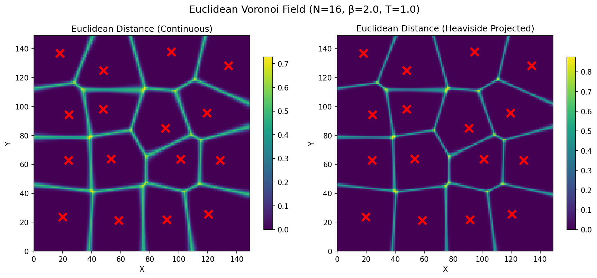

# Voronoi Core

中文 | [English](README_en.md)

基于 JAX 的高性能 Voronoi 场计算库。

## 论文引用

本项目是以下论文的核心计算模块：

> Changkun Sun, Yongbo Deng, Nanya Li. **Differentiable Voronoi diagram towards a new design method for the additive manufacturing of 3D disordered cellular structure**. *Engineering Structures*, 364:123138, July 2026. DOI: [10.1016/j.engstruct.2026.123138](https://doi.org/10.1016/j.engstruct.2026.123138)

## 许可证

本项目采用 [MIT 许可证](LICENSE) 开源。您可以自由使用、修改和分发本代码，但需保留版权声明。

## 安装

### 方式1: pip install

```bash
pip install -e .
```

然后直接导入模块：

```python
from density import soft_density
from field import compute_voronoi
from utils import generate_identity_D
```

### 方式2: git submodule

```bash
git submodule add <repo-url> d_Voronoi_core
```

然后将 `d_Voronoi_core` 的父目录添加到 Python 路径，或直接导入：

```python
import sys
sys.path.append('path/to/parent')
from d_Voronoi_core import compute_voronoi
```

## 依赖

- `jax>=0.4.0`
- `jaxlib>=0.4.0`
- `numpy>=1.24.0`

## 术语

| 术语 | 说明 |
|------|------|
| **seed** | Voronoi 种子点 |
| **unit** | 待求点/场点 |
| **D** | 变换矩阵（D=I 时为欧几里得距离） |
| **cp** | 控制点（影响方向敏感性） |

## 示例展示

### 欧几里得 Voronoi 场

使用欧几里得距离（D=I）的标准 Voronoi。左图：连续密度场；右图：Heaviside 投影后。



### 马氏距离 Voronoi 场

使用马氏距离的各向异性 Voronoi，每个种子点有不同的 D 矩阵，产生方向性拉伸效果。


## 快速开始

```python
from field import compute_voronoi, make_voronoi_fn
from density import compute_gamma
import numpy as np

# 创建网格
Nx, Ny = 100, 100
coords = np.stack(np.indices((Nx, Ny)), axis=-1)

# 种子点
seeds = np.array([[25, 25], [75, 25], [50, 75]], dtype=float)
N = seeds.shape[0]

# 变换矩阵（D=I 时为欧几里得距离）
D = np.tile(np.eye(2), (N, 1, 1))

# 方式1: 直接调用
field = compute_voronoi(coords, seeds, D, beta=2.0, temperature=1.0)

# 方式2: 预绑定静态参数（推荐用于优化循环）
voronoi = make_voronoi_fn(beta=2.0)
for epoch in range(100):
    eta = 0.3 + 0.4 * (epoch / 100)
    gamma = compute_gamma(epoch)
    field = voronoi(coords, seeds, D, temperature=1.0, eta=eta, gamma=gamma)
```

## 距离类型

通过 D 矩阵和 cp 参数切换：

```python
from distances import mahalanobis_single

# 1. 欧几里得距离（D=I）
D_I = np.tile(np.eye(2), (N, 1, 1))
dist = mahalanobis_single(unit, seeds, D_I)

# 2. 马氏距离（各向异性）
D = np.array([[[2, 0.5], [0.5, 1]], ...])
dist = mahalanobis_single(unit, seeds, D)

# 3. 带遮罩马氏距离（考虑方向）
cp = seeds + np.array([5, -5])
dist = masked_mahalanobis_single(unit, seeds, D, cp, sigma=0.1, scale=3.0)
```

## 函数签名

### `compute_voronoi`

```python
def compute_voronoi(
    coords,        # 场坐标 (Nx, Ny, dim)
    seeds,         # 种子点 (N, dim)
    D,             # 变换矩阵 (N, dim, dim)
    cp=None,       # 控制点 (N, dim)，可选
    beta=2.0,      # 边界锐度（保持在 2 或 2.66 附近）
    sigma=0.1,     # 遮罩宽度（0.03-0.3）
    scale=3.0,     # 遮罩强度（1-5）
    temperature=1.0,  # 温度系数 T（控制结构宽度）
    eta=0.5,       # Heaviside 阈值（0.3-0.7）
    gamma=1.0,     # 投影锐度（compute_gamma(epoch)）
    batch_size=20
)
```

### `make_voronoi_fn`

```python
voronoi = make_voronoi_fn(
    beta=2.0,
    sigma=0.1,
    scale=3.0,
    batch_size=20
)

# 返回的函数：
field = voronoi(coords, seeds, D, cp=None, temperature=1.0, eta=0.5, gamma=1.0)
```

## 数学原理

### 软 Voronoi 密度

$$soft_i = \frac{\exp(-d_i/T)}{\sum_j \exp(-d_j/T)}, \quad \rho = 1 - \sum_i soft_i^\beta$$

其中：
- **T (temperature)**: 温度系数，控制 softmax 的锐度
  - T < 1: 分布更集中，边界更锐利，结构更窄
  - T > 1: 分布更分散，边界更平滑，结构更宽
  - T = 1: 标准 softmax
- **beta**: 边界锐度，保持在 2 或 2.66 附近（控制密度幂次）

### Heaviside 投影（最后一步）

$$\rho' = \frac{\tanh(\gamma\eta) + \tanh(\gamma(\rho-\eta))}{\tanh(\gamma\eta) + \tanh(\gamma(1-\eta))}$$

### 开胞/闭胞转换（beta=2）

当 beta=2 时，三维 Voronoi 结构中不同部分的密度分布：
- **面（shell）**：密度约 0.5
- **杆（rod）**：密度约 0.6

通过在 0.5-0.6 之间选择一个 eta 阈值，将密度低于该值的单元过滤掉，即可从三维闭胞 Voronoi 获得三维开胞 Voronoi。

```python
# 闭胞 Voronoi（默认 eta=0.5）
field_closed = compute_voronoi(coords, seeds, D, beta=2.0, eta=0.5)

# 开胞 Voronoi（eta 在 0.5-0.6 之间）
field_open = compute_voronoi(coords, seeds, D, beta=2.0, eta=0.55)
```

## 文件结构

```
d_Voronoi_core/
├── __init__.py      # 公共接口
├── density.py       # soft_density, heaviside, compute_gamma
├── distances.py     # mahalanobis, masked_mahalanobis
├── field.py         # compute_voronoi, make_voronoi_fn
├── utils.py         # generate_random_seeds, generate_identity_D
├── demo/            # 示例脚本和图片
├── README.md        # 英文文档
├── README_zh.md     # 中文文档
├── ai_agent_looks_here.md  # AI agent 详细技术文档
├── LICENSE          # MIT 许可证
├── pyproject.toml
└── requirements.txt
```

## AI Agent 文档

本项目为 AI agent 提供了详细的技术参考文档：[ai_agent_looks_here.md](ai_agent_looks_here.md)

该文档包含：
- 所有函数的完整签名、参数说明和返回值
- 数学原理的详细解释
- 实现细节和设计决策
- 常见任务的完整代码示例
- 参数范围建议和注意事项
